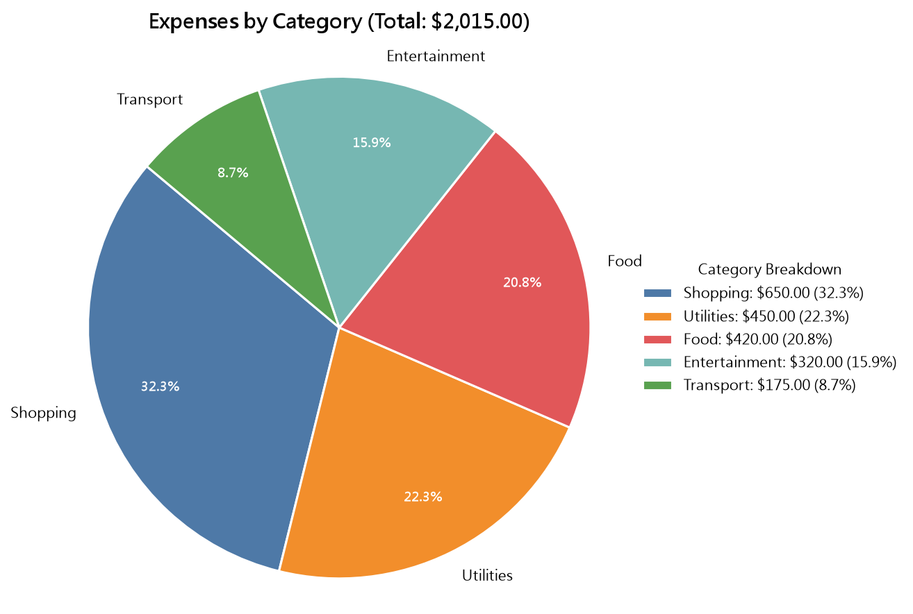

# Expense Tracker (Assignment 1 — Version Control Practice)

A collaborative Python CLI expense tracker built in pairs for **Introduction to Software Engineering — Assignment 1**. Users can record daily expenses by category and visualize spending distribution with a pie chart.

## Team Roles & Branch Structure

- **Member A (`feature-input`)**: Input module (`expense_input.py`) — interactive expense entry with date/amount validation, category selection, expense summary view, and CSV persistence (`expenses.csv`).
- **Member B (`feature-piechart`)**: Visualization module (`visualize.py`) — aggregates `expenses.csv` by category, renders a formatted pie chart with `matplotlib`, and exports `sample_pie_chart.png`.
- **Integration (`main`)**: Unified launcher (`main.py`) combining both modules into a single CLI workflow.

## Prerequisites & Setup

1. Ensure Python 3.10+ is installed.
2. Install dependencies:
   ```bash
   pip install -r requirements.txt
   ```

## How to Run

### Option 1: Unified Application (Recommended)
```bash
python main.py
```
From the menu, you can:
1. Add one or more expenses (`date`, `amount`, `category`, optional `notes`)
2. View recorded expenses and total spending
3. Generate and display the category pie chart (also saved to `sample_pie_chart.png`)
4. Load sample expenses for quick testing

### Option 2: Run Modules Individually

**Input module:**
```bash
python expense_input.py
```

**Visualization module:**
```bash
python visualize.py
```
To save `sample_pie_chart.png` without opening a GUI window:
```bash
python visualize.py --no-show
```

## Sample Output


